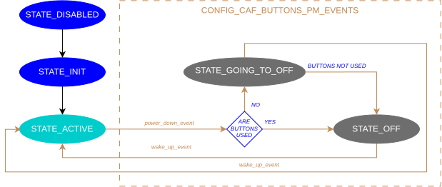
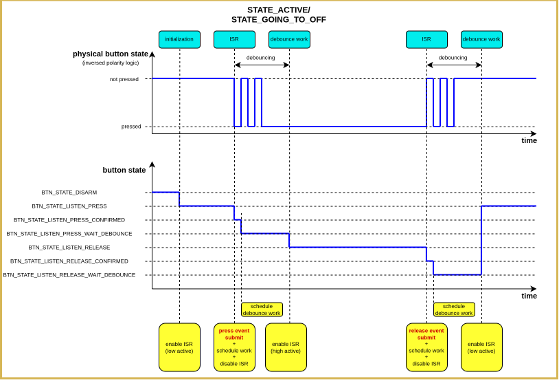

.. _caf_buttons_isr:

CAF: Buttons module (ISR)
#########################

.. contents::
   :local:
   :depth: 2

The |hid_addon| provides an alternative implementation of the :ref:`CAF buttons module <nrf:caf_buttons>`.
It emits a :c:struct:`button_event` on button press and release with minimal latency.
The module uses GPIO interrupts and applies debouncing after press and release detection.

Use this module for directly connected buttons when low button press latency is required.
It can reduce the time from a physical button press to a :c:struct:`button_event` submission.
For keyboard matrices or when minimal latency is not required, use the standard :ref:`CAF buttons module <nrf:caf_buttons>` from the |NCS| (:kconfig:option:`CONFIG_CAF_BUTTONS`).

Configuration
*************

To use the module, you must enable the following Kconfig options:

* :option:`CONFIG_CAF_BUTTONS_ISR` - This option enables the low-latency buttons module.
  You cannot enable it together with :kconfig:option:`CONFIG_CAF_BUTTONS`.
* :kconfig:option:`CONFIG_GPIO` - This option enables Zephyr's :ref:`zephyr:gpio_api` driver, which is required for interacting with the GPIO pins.

Configuration file
==================

When you define how the buttons are connected, you must create a configuration file with the following arrays:

* ``row`` contains GPIO pins to which buttons are directly connected (one button for each pin).
  The array can contain up to 32 buttons.
* ``col`` must be defined as an empty array.
  Keyboard matrix is not supported.
* Each GPIO port used by a button must have an associated GPIOTE instance.

For example, the file contents should look as follows:

.. code-block:: c

	#include <caf/gpio_pins.h>

	static const struct gpio_pin col[] = {};

	static const struct gpio_pin row[] = {
		{ .port = 1, .pin = 26 },
		{ .port = 1, .pin = 9  },
	};

You must define both arrays in this configuration file, and specify its location using the :option:`CONFIG_CAF_BUTTONS_DEF_PATH` Kconfig option.

.. note::
   The configuration file should be included only by the configured module.
   Do not include the configuration file in other source files.

Configuration options
=====================

The following Kconfig options are available for this module:

* :option:`CONFIG_CAF_BUTTONS_DEF_PATH` - Location of the module configuration file.
  The default value is :file:`buttons_def.h`.
* :option:`CONFIG_CAF_BUTTONS_PM_EVENTS` - Power management events support.
  See :ref:`caf_buttons_isr_pm_configuration` for details.
* :option:`CONFIG_CAF_BUTTONS_PM_KEEP_ALIVE` - Generate :c:struct:`keep_alive_event` on button press (requires :kconfig:option:`CONFIG_CAF_POWER_MANAGER`).
  The feature is implemented by the :ref:`CAF power manager keep alive module for buttons <nrf:caf_buttons_pm_keep_alive>` in the |NCS|, which reacts to :c:struct:`button_event` submitted by this module.
* :option:`CONFIG_CAF_BUTTONS_POLARITY_INVERSED` - Inverse button polarity.
  By default, a button press is indicated by a pin switch from the low to the high state.
  When this option is enabled, the application treats a switch from the high to the low state as a button press.
* :option:`CONFIG_CAF_BUTTONS_DEBOUNCE_INTERVAL` - Debounce interval in milliseconds.
  The default value is 2 ms.
  The module waits for this interval before enabling the listener for the opposite pin state after press or release detection.
* :option:`CONFIG_CAF_BUTTONS_WQ` - Use a dedicated workqueue for button debouncing works.
  When enabled, debouncing works run on a dedicated workqueue instead of the system workqueue, which can reduce interference with other work.
  When disabled, the system workqueue is used and memory footprint is lower.
* :option:`CONFIG_CAF_BUTTONS_WQ_STACK_SIZE` - Stack size of the dedicated workqueue (if :option:`CONFIG_CAF_BUTTONS_WQ` is enabled).
  The default value is 1024 bytes.
* :option:`CONFIG_CAF_BUTTONS_WQ_PRIO` - Priority of the dedicated workqueue (if :option:`CONFIG_CAF_BUTTONS_WQ` is enabled).
  The default value is ``-1``.
  Only cooperative priorities are supported.
* :option:`CONFIG_CAF_BUTTONS_NRF54LS05_SPURIOUS_PRESSES_WORKAROUND` - Filter spurious GPIOTE PORT callbacks on nRF54LS05.
  Workaround for ``NCSDK-41091``: when one button on a GPIO port is pressed, the ISR can still be invoked for other pins on the same port.
  If enabled, the module reads each pin in the ISR and ignores callbacks that do not match the expected pressed or released level.
  This GPIO read on the interrupt path can slightly increase click latency compared to trusting the PORT callback alone.

.. _caf_buttons_isr_pm_configuration:

Power management configuration
==============================

If the :option:`CONFIG_CAF_BUTTONS_PM_EVENTS` Kconfig option is enabled, the module interacts with power management events (:c:struct:`power_down_event`, :c:struct:`power_off_event`, and :c:struct:`wake_up_event`).

You can use the module to trigger application wakeup.
By default, pressing any button wakes up the application.
In the configuration file, you can specify which buttons should not trigger an application wakeup.
Mark such buttons in the ``row`` array by setting :c:member:`gpio_pin.wakeup_blocked` to ``true``.
See an example of the modified configuration file:

.. code-block:: c

	#include <caf/gpio_pins.h>

	static const struct gpio_pin col[] = {};

	static const struct gpio_pin row[] = {
		{ .port = 0, .pin = 9, .wakeup_blocked = true },
		{ .port = 0, .pin = 8, .wakeup_blocked = true },
		{ .port = 1, .pin = 15 },
		{ .port = 1, .pin = 14 },
	};

After you apply the change, the module still handles a marked button but no longer triggers the application wakeup.

Implementation details
**********************

Depending on the configuration, the module-level state machine uses from two to five states.
The following figure shows all states and transitions.
Paths that depend on :option:`CONFIG_CAF_BUTTONS_PM_EVENTS` are marked accordingly.

If :option:`CONFIG_CAF_BUTTONS_PM_EVENTS` is disabled, the module operates in ``STATE_ACTIVE`` after initialization.
Only ``STATE_ACTIVE`` and ``STATE_ERROR`` are used during normal runtime (``STATE_DISABLED`` and ``STATE_INIT`` occur briefly at boot).

If :option:`CONFIG_CAF_BUTTONS_PM_EVENTS` is enabled, the module can also enter ``STATE_GOING_TO_OFF`` and ``STATE_OFF`` while handling power management events.
See :ref:`caf_buttons_isr_pm_states` for details.

   State transitions of the CAF buttons ISR module

Each button is handled by a dedicated state machine.
The module uses level-triggered GPIO interrupts to detect both press and release.

   State transitions of a single button

After initialization, the module switches to ``STATE_ACTIVE`` and enables press listeners on all configured buttons.

When a button press is detected, the module immediately submits a :c:struct:`button_event` with :c:member:`button_event.pressed` set to ``true``.
The module then disables the GPIO interrupt for that button and starts the press debounce interval handling.

The module applies the debounce interval in two steps

* Scheduling a delayed work item requires GRTC register access, which can take a long time right after the CPU wakes up from idle.
  To avoid that access in the GPIO interrupt handler, the module first submits the debounce work with no delay.
* When that work runs, it switches the button from ``BTN_STATE_LISTEN_PRESS_CONFIRMED`` to ``BTN_STATE_LISTEN_PRESS_WAIT_DEBOUNCE`` and reschedules the same work with a timeout equal to :option:`CONFIG_CAF_BUTTONS_DEBOUNCE_INTERVAL`.
  After this second step completes, the module enables a release listener on the button.

When a button release is detected, the module immediately submits a :c:struct:`button_event` with :c:member:`button_event.pressed` set to ``false``.
The module then disables the GPIO interrupt for that button and applies the release debounce interval using the same two-step approach (``BTN_STATE_LISTEN_RELEASE_CONFIRMED`` followed by ``BTN_STATE_LISTEN_RELEASE_WAIT_DEBOUNCE``).

After the release debounce interval expires, the module re-enables the press listener for that button.

The debounce interval prevents the module from enabling the listener for the opposite pin state too early, which filters signal bouncing.
Button events are submitted immediately after the pin state change is detected.

If a button is already pressed when listeners are enabled, the level-triggered press interrupt fires and the press is handled in the interrupt callback.

If :option:`CONFIG_CAF_BUTTONS_WQ` is enabled, debouncing works run on a dedicated workqueue instead of the system workqueue.
This can reduce interference with other work submitted to the system workqueue.

Key ID
======

The :c:member:`button_event.key_id` is a unique 2-byte value that depends on the module configuration described in the configuration file.

The following table breaks down the :c:member:`button_event.key_id` bits.

+------------------------------+
| key_id                       |
+---------+---------+----+-----+
| 0 .. 6  | 7 .. 13 | 14 | 15  |
+=========+=========+====+=====+
| Row idx | Col idx | Reserved |
+---------+---------+----------+

In this :c:member:`button_event.key_id` value, the bits are distributed as follows:

* The first seven least significant bits (``Row idx``) encode the index of the ``row`` array that corresponds to the GPIO port and the pin to which the button is connected.
* The next seven bits (``Col idx``) are set to zero for directly connected buttons.
* The last two bits are reserved for application-specific usage.

For example, if the configuration file defines a button at index ``3`` in the ``row`` array (port ``1``, pin ``14``), a :c:struct:`button_event` related to that button has the row index encoded in the least significant bits of the :c:member:`button_event.key_id`.

.. _caf_buttons_isr_pm_states:

Power management states
=======================

If the :option:`CONFIG_CAF_BUTTONS_PM_EVENTS` Kconfig option is enabled, the module can react to power management events and submit a :c:struct:`wake_up_event`.
In that case, the following additional states are available:

* ``STATE_GOING_TO_OFF``
* ``STATE_OFF``

The power management events that the module can react to are the following:

* :c:struct:`power_down_event`
* :c:struct:`power_off_event`
* :c:struct:`wake_up_event`

If a :c:struct:`power_down_event` is received while the module is in the ``STATE_ACTIVE`` state and no button interaction is in progress, the module immediately switches to ``STATE_OFF``.
If any button is still pressed or debouncing is in progress, the module switches to ``STATE_GOING_TO_OFF`` and rejects the event.
The module remains in ``STATE_GOING_TO_OFF`` until all buttons complete the current press/release cycle, then switches to ``STATE_OFF``.

In ``STATE_OFF``, GPIO interrupts are enabled only for buttons configured to wake up the application.
Pressing any of these buttons submits a :c:struct:`wake_up_event`.
Receiving a :c:struct:`wake_up_event` switches the module back to ``STATE_ACTIVE``.

.. note::
  If the system enters the off state (indicated by :c:struct:`power_off_event`), a button press triggers an instant system reboot (:c:func:`sys_reboot`).
  This is done to prevent entering the system off state with GPIO interrupts disabled.
  System reboot is anyway necessary to wake up from the system off state.
